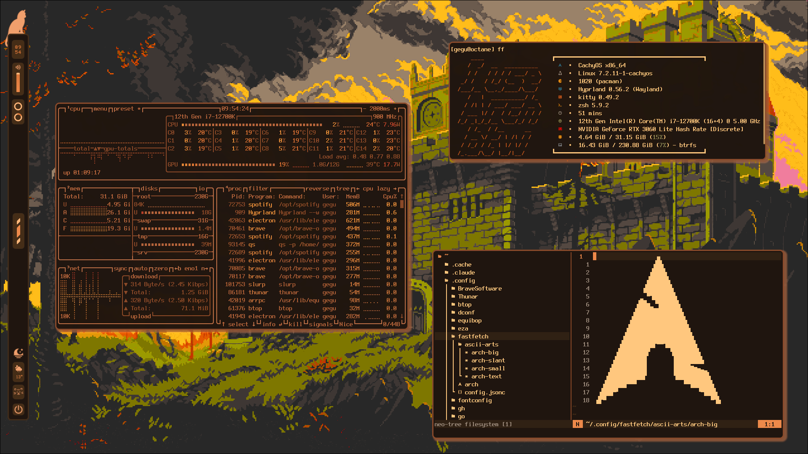
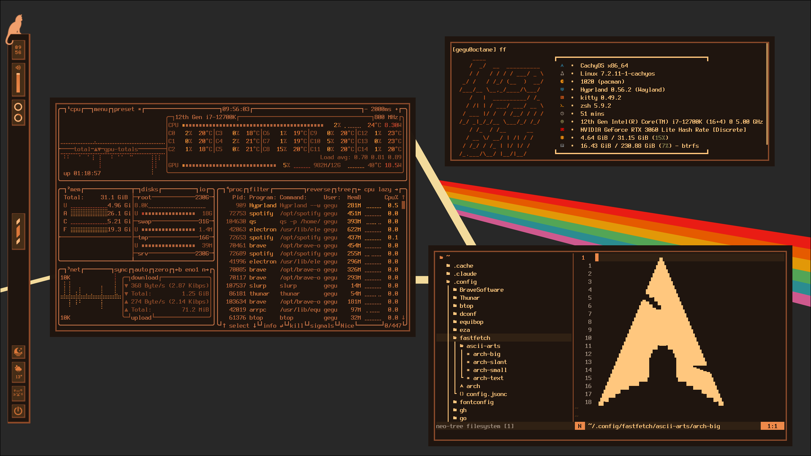
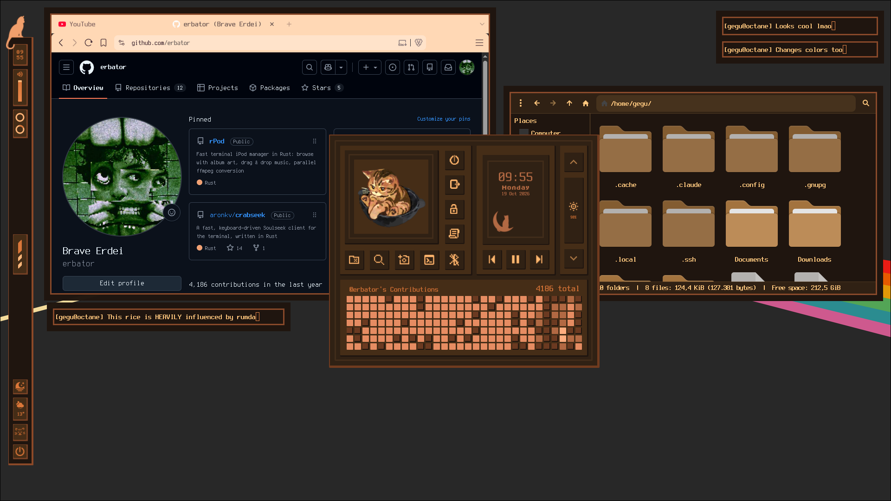
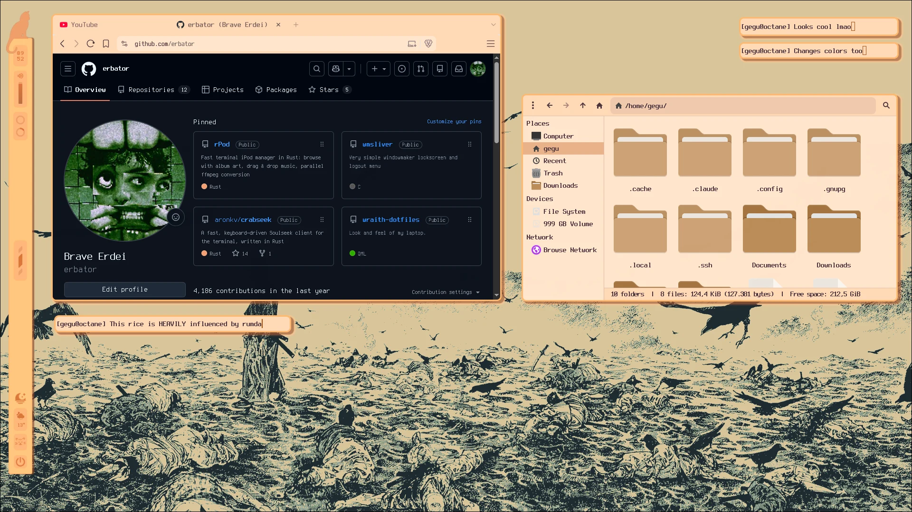
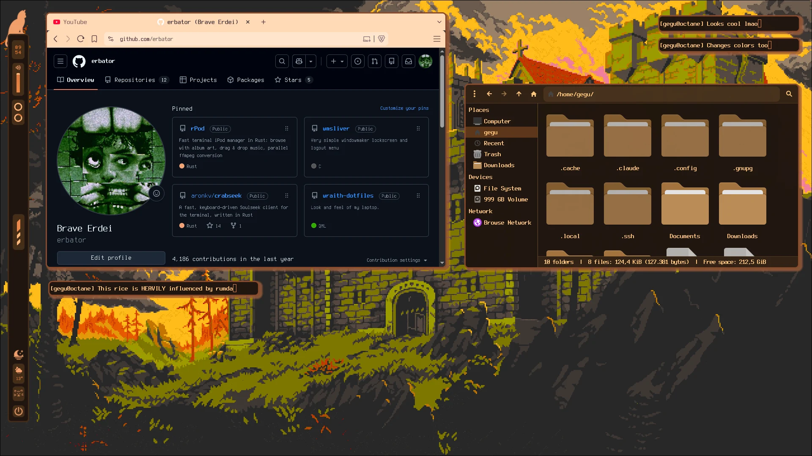
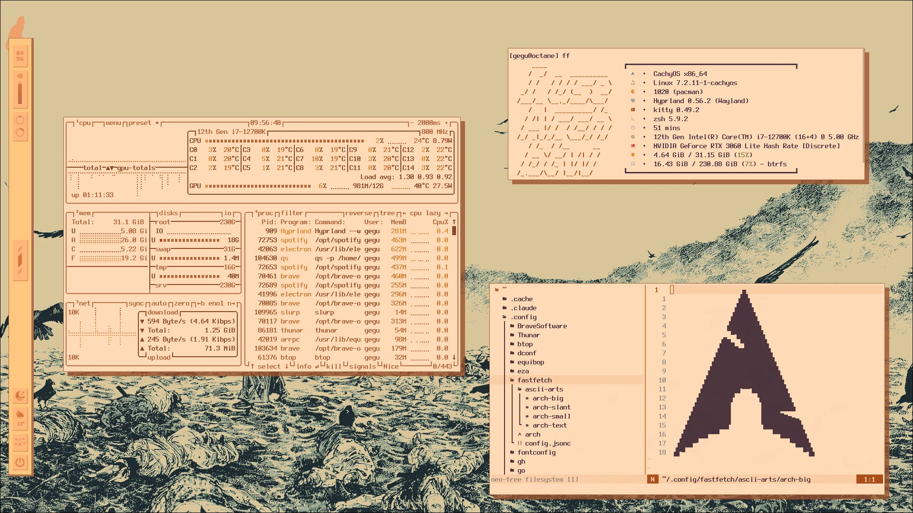
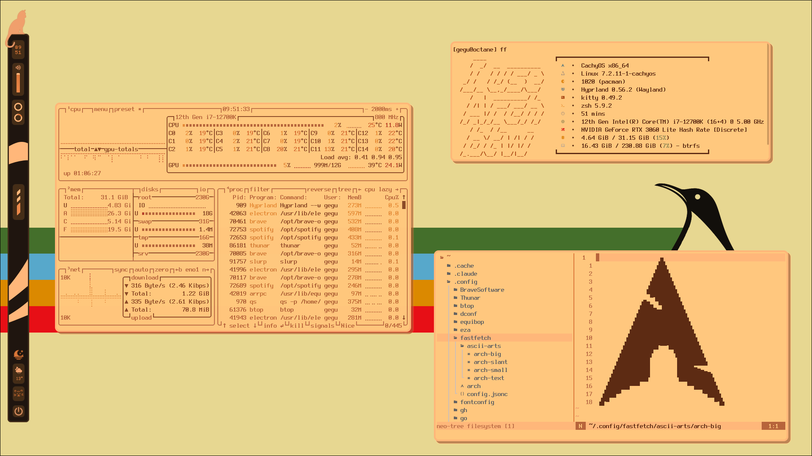
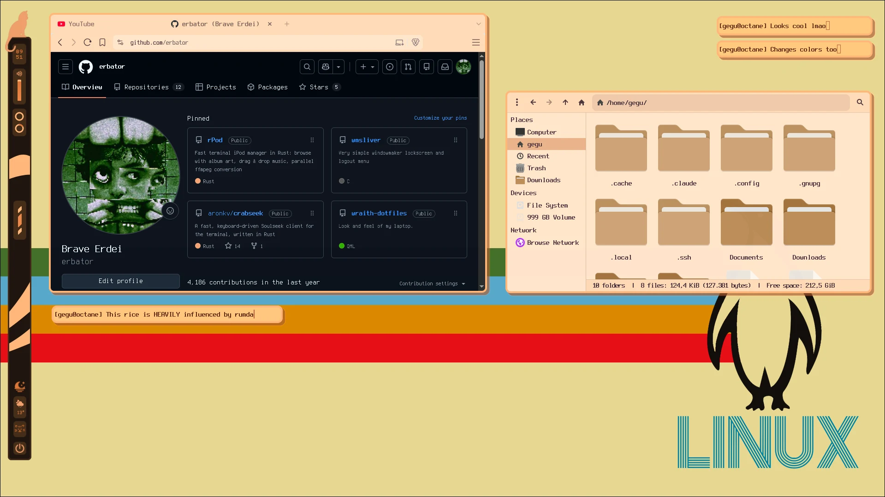

<div align="center">

# seqbox

**My Hyprland dotfiles, themed with rumda**




**[Main](#main)** · **[Pixel](#pixel)** · **[Warm](#warm)** · **[Install](#installation)** · **[Keybinds](#keybinds)**

</div>

---

## Overview

A Hyprland desktop built around **rumda**, a set of scripts that recolours the whole
system at once: Quickshell bar, Hyprland, kitty, Neovim, btop, rofi, GTK apps, Brave,
Discord, Spotify and the wallpaper.

- **Modes:** `light` and `dark`
- **Flavours:** `main`, `pixel` and `warm`, each with its own bar, window style and wallpaper

The vertical bar on the left, with Rumda the cat sitting on top, holds:

- **Top:** clock, volume, CPU and RAM rings
- **Middle:** workspaces
- **Bottom:** light/dark switch, weather, network and power

## Flavours

### Main

Rounded windows with soft shadows. The dark mode uses the Pink Floyd prism, the light
mode an ink drawing of crows.

<table>
  <tr>
    <td width="50%"></td>
    <td width="50%"></td>
  </tr>
  <tr>
    <td align="center"><sub><b>Dark:</b> btop, fastfetch and Neovim with neo-tree, all in kitty</sub></td>
    <td align="center"><sub><b>Light:</b> the same windows after <code>theme.sh light</code></sub></td>
  </tr>
  <tr>
    <td width="50%"></td>
    <td width="50%"></td>
  </tr>
  <tr>
    <td align="center"><sub><b>Dashboard</b> (<kbd>Super</kbd> + <kbd>Tab</kbd>): power menu, shortcuts, clock, media controls, brightness and a GitHub contribution graph</sub></td>
    <td align="center"><sub><b>Light:</b> Brave and Thunar pick up the GTK colours, with small kitty windows floating on top</sub></td>
  </tr>
</table>

### Pixel

Square corners, 1px borders and hard 9px drop shadows, with a pixel-art bar to match.

<table>
  <tr>
    <td width="50%"></td>
    <td width="50%"></td>
  </tr>
  <tr>
    <td align="center"><sub><b>Dark:</b> terminals over the pixel-art castle</sub></td>
    <td align="center"><sub><b>Dark:</b> Brave and Thunar in the dark GTK theme</sub></td>
  </tr>
  <tr>
    <td width="50%"></td>
    <td width="50%"></td>
  </tr>
  <tr>
    <td align="center"><sub><b>Light:</b> terminals</sub></td>
    <td align="center"><sub><b>Light:</b> Brave and Thunar</sub></td>
  </tr>
</table>

### Warm

Peach and brown on a retro striped wallpaper, with thick rounded borders.

<table>
  <tr>
    <td width="50%"></td>
    <td width="50%"></td>
  </tr>
  <tr>
    <td align="center"><sub>btop, fastfetch and Neovim</sub></td>
    <td align="center"><sub>Brave, Thunar and floating kitty windows</sub></td>
  </tr>
</table>

## Setup

| | |
| --- | --- |
| **OS** | CachyOS (Arch) |
| **WM** | Hyprland, configured in Lua |
| **Bar / widgets** | Quickshell |
| **Terminal** | kitty |
| **Shell** | zsh + starship |
| **Editor** | Neovim |
| **Launcher** | rofi |
| **File manager** | Thunar |
| **Wallpaper** | awww |
| **Font** | Terminess Nerd Font |
| **Icons** | Papirus |

## Contents

The repo mirrors `$HOME`.

| Path | Contents |
| --- | --- |
| `.config/hypr` | Hyprland config, split into modules (binds, rules, look, monitors, …) |
| `.config/quickshell` | Bar, dashboard and widgets, light and dark |
| `.config/rumda` | Theme and flavour switcher, scripts, wallpapers, shaders |
| `.config/kitty` | Terminal config and themes |
| `.config/nvim` | Neovim config with the rumda colourscheme |
| `.config/rofi` | Launcher themes for every flavour and mode |
| `.zshrc` | zsh with fzf-tab, autosuggestions, zoxide |
| `.config/starship.toml` | Prompt |
| `.config/equibop` | Discord client settings and the system24 ember theme |
| `.config/spicetify` | Spotify theme |
| `.config/gtk-3.0` · `.config/gtk-4.0` | GTK settings and colours |
| `.config/fastfetch` · `btop` · `eza` · `swappy` · `fontconfig` | Smaller tool configs |

## Installation

> [!WARNING]
> Back up your own configs first. Copying overwrites files with the same name.

```sh
git clone https://github.com/erbator/seqbox.git ~/seqbox

# one app
cp -r ~/seqbox/.config/kitty ~/.config/

# everything
cp -r ~/seqbox/.config/. ~/.config/
cp ~/seqbox/.zshrc ~/
```

## Dependencies

```sh
paru -S --needed hyprland quickshell kitty neovim rofi thunar zsh starship \
  awww grim slurp swappy wl-clipboard wf-recorder tesseract tesseract-data-eng libnotify \
  brightnessctl playerctl fastfetch btop eza bat ripgrep fzf zoxide direnv \
  zsh-autosuggestions fzf-tab ttf-terminus-nerd papirus-icon-theme \
  equibop spicetify-cli
```

## Keybinds

`Super` is the main modifier.

| Keys | Action |
| --- | --- |
| `Super + Return` | Terminal |
| `Super + D` | App launcher |
| `Super + E` | File manager |
| `Super + Q` | Close window |
| `Super + F` | Fullscreen |
| `Super + U` | Toggle floating |
| `Super + J` | Toggle split |
| `Super + Tab` | Dashboard |
| `Super + W` | Next wallpaper |
| `Super + Z` | Zoom |
| `Super + S` | Scratchpad (`Shift` to move a window there) |
| `Super + 1…0` | Workspace (`Shift` to move a window there) |
| `Super + arrows` | Move focus |
| `Print` | Region screenshot to clipboard |
| `Super + Print` | Region screenshot into swappy |
| `Super + Shift + T` | OCR a region to clipboard |
| `Super + Shift + R` | Record screen (`Alt` instead of `Shift` for a region) |
| `Super + M` | Exit Hyprland |

## rumda

```sh
~/.config/rumda/scripts/theme.sh light|dark      # switch mode
~/.config/rumda/scripts/flavour.sh main|pixel|warm  # switch flavour
```

| Script | Does |
| --- | --- |
| `theme.sh` | Switches kitty, Neovim, rofi, GTK, the system colour scheme, Hyprland colours and the wallpaper |
| `flavour.sh` | Swaps the Quickshell bar and Hyprland look. Runs at login to start the saved flavour |
| `wall.sh` / `wallcycle.sh` | Sets or cycles the wallpaper for the current mode |
| `screenshot.sh` / `qscreen.sh` / `delayedScreenshot.sh` | Screenshots |
| `screenrec.sh` | Screen recording (full screen or region) |
| `ocr.sh` | Text recognition from a screen region |
| `zoom_toggle.sh` · `vibrance.sh` | Screen zoom and a colour vibrance shader |

The active mode and flavour are saved in `~/.cache/rumda-theme` and
`~/.cache/rumda-flavour`.

> [!NOTE]
> Switching theme rewrites a few tracked files (`kitty/current-theme.conf`,
> `rofi/current.rasi`, `gtk-4.0/gtk.css`, `gtk-*/settings.ini`), so they show up in
> `git status` after a switch.
