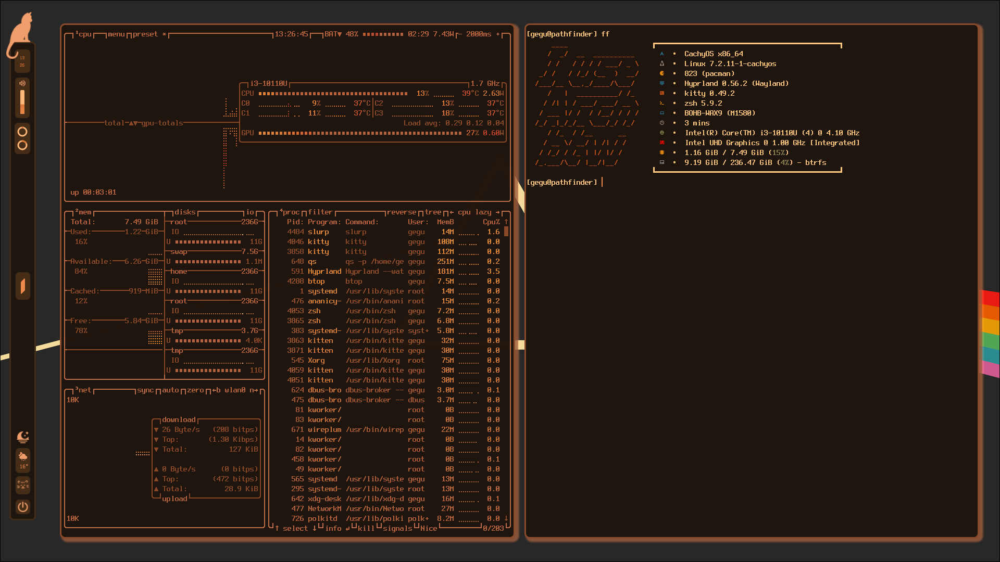
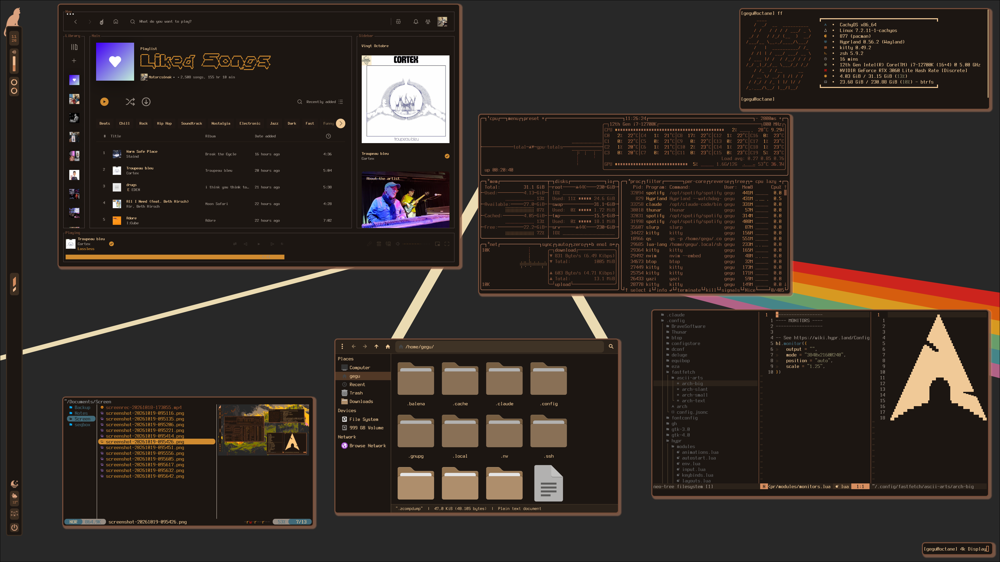

<div align="center">

# seqbox

**Seqbox, sequel to my gruvbox dots, get it? based on [rumda](https://github.com/hexonide/rumda) by [@hexonide](https://github.com/hexonide)**


**[Screenshots](#screenshots)** · **[Usage](#usage)** · **[Install](#installation)** · **[Credits](#credits)**

</div>

---

## Screenshots

### Main

<table>
  <tr>
    <td width="50%"></td>
    <td width="50%"></td>
  </tr>
  <tr>
    <td width="50%"></td>
    <td width="50%"></td>
  </tr>
</table>

### Pixel

<table>
  <tr>
    <td width="50%"></td>
    <td width="50%"></td>
  </tr>
  <tr>
    <td width="50%"></td>
    <td width="50%"></td>
  </tr>
</table>

### Warm

<table>
  <tr>
    <td width="50%"></td>
    <td width="50%"></td>
  </tr>
</table>

### Light on resources

**1.2 GB RAM · 7.4 W on battery** on an i3-10110U laptop with 8 GB of RAM.



### 4K display

**3840×2160 at 1.25× scale**, main flavour in dark mode.



## Usage

```sh
~/.config/rumda/scripts/theme.sh light|dark         # or the moon/sun button on the bar
~/.config/rumda/scripts/flavour.sh main|pixel|warm
```

| Keys | Action |
| --- | --- |
| `Super + Return` | Terminal |
| `Super + D` | App launcher |
| `Super + E` | File manager |
| `Super + Q` | Close window |
| `Super + F` | Fullscreen |
| `Super + U` | Toggle floating |
| `Super + J` | Toggle split |
| `Super + Tab` | Dashboard |
| `Super + W` | Next wallpaper |
| `Super + Z` | Zoom |
| `Super + S` | Scratchpad (`Shift` to move a window there) |
| `Super + 1…0` | Workspace (`Shift` to move a window there) |
| `Super + arrows` | Move focus |
| `Print` | Region screenshot to clipboard |
| `Super + Print` | Region screenshot into swappy |
| `Super + Shift + T` | OCR a region to clipboard |
| `Super + Shift + R` | Record screen (`Alt` instead of `Shift` for a region) |
| `Super + M` | Exit Hyprland |

## Installation

For Arch-based systems with [paru](https://github.com/Morganamilo/paru) and Hyprland 0.56+.
Back up your configs first.

```sh
paru -S --needed git hyprland quickshell qt6-5compat kitty neovim tree-sitter-cli rofi thunar \
  zsh starship awww grim slurp swappy wl-clipboard wf-recorder tesseract tesseract-data-eng \
  libnotify brightnessctl playerctl fastfetch btop eza bat ripgrep fzf zoxide direnv \
  zsh-autosuggestions fzf-tab ttf-terminus-nerd papirus-icon-theme adw-gtk-theme
chsh -s /usr/bin/zsh

git clone https://github.com/erbator/seqbox.git ~/Documents/seqbox
cd ~/Documents/seqbox
cp -r .config/. ~/.config/
cp .zshrc ~/
mkdir -p ~/.local/share && cp -r .local/share/themes ~/.local/share/
```

Then adjust:

- `~/.config/hypr/modules/monitors.lua`: set `mode` to `"preferred"` or your own mode
- `~/.config/hypr/modules/input.lua`: keyboard layout is `hu`

Log in to Hyprland and run `flavour.sh main` and `theme.sh dark`.
The pixel flavour needs the [Dogica](https://rmocci.itch.io/dogica) font in `~/.local/share/fonts`.

## Credits

- **[hexonide/rumda](https://github.com/hexonide/rumda):** the original rice: the bar, dashboard, Rumda the cat, the flavours and the scripts. Go star it.
- The system24 Discord theme is by [refact0r](https://github.com/refact0r/system24).
